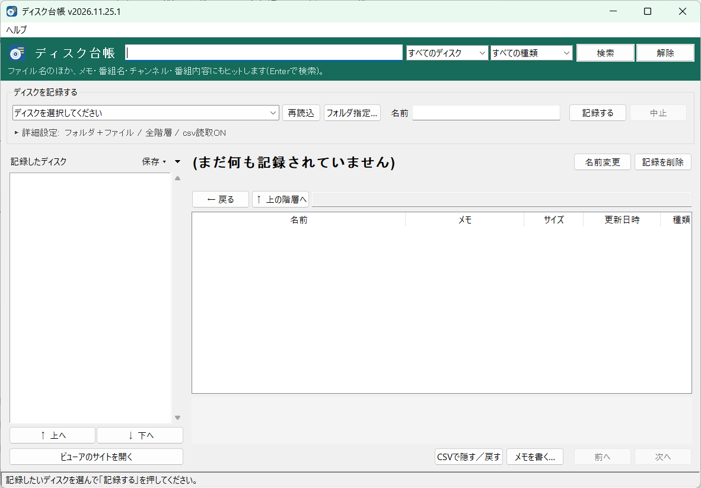

# ディスク台帳 (Disk-Daicho)

外付けHDD・DVD・BD・USBメモリなどの**中身(フォルダ/ファイル構成)を記録**しておき、
ディスクを繋がなくても中身の確認・検索ができる Windows 用ソフトです。

「あのファイル、どのHDDに入れたっけ？」を、HDDを1台ずつ繋がずに調べられます。

## 使い方

1. [Python](https://www.python.org/) 3.8 以降をインストール (追加ライブラリは不要)
2. `disk_daicho.pyw` をダウンロードして、好きなフォルダに置く ([ビューアのページ](https://tatata17.github.io/Disk-Daicho/)にダウンロードボタンがあります)
3. ダブルクリックで起動
4. 記録したいディスクを選び、名前を付けて「記録する」

記録データは `disk_daicho.pyw` と同じフォルダの `disk_daicho.db` に保存されます。

## できること

- **記録** … ドライブまたは任意のフォルダを記録。「フォルダ＋ファイル / フォルダのみ」、記録する階層の指定、途中での中止に対応
- **閲覧** … ディスクを繋がずにフォルダをたどって中身を確認。フォルダごとの合計サイズも表示
- **検索** … すべてのディスクを横断してファイル名で検索。動画・音声・画像などの種類で絞り込み
- **ワンクリック更新** … 記録済みのディスクを繋ぐと「接続されています」と出て、ボタン1つで今の内容に更新できます。前回との差(新規・削除・サイズ変化・合計の増減)も表示します
- **同じディスクの判別** … ボリュームシリアル番号で見分けるので、ドライブ文字(D: や G:)が変わっても同じディスクと分かり、記録を更新できます
- **番組情報の読み取り** … [m2ts-encoder](https://github.com/tatata17/m2ts-encoder) が動画と同名で出力する csv があれば、番組名・放送日・チャンネル・番組内容も一緒に記録し、検索できます。読み取った csv は一覧には出さず、動画に「番組情報あり」と表示します(ディスク上の csv はそのままです)
- **メモ** … ファイルやフォルダごとにメモを書けます。名前を付け直していない iso などに「これは何のファイルか」を残せて、検索にもヒットします。メモは台帳に書くだけで、ディスクのファイルには書き込みません
- **アップデート** … 「ヘルプ → アップデートを確認」で最新版に更新できます。今の版は自動でバックアップし、記録データはそのまま残ります。起動時にも自動で確認します(オフにできます)
- **CSVで隠す** … 人に渡すCSVに出したくないファイルやフォルダを選んで、書き出しから外せます(フォルダは中身ごと。上のフォルダの合計サイズからも引きます)。ソフトの画面では今までどおり見えます。記録データ(`disk_daicho.db`)のバックアップには全部入るので、人に渡すときはCSVを使ってください
- **管理** … 並べ替え、名前変更、記録の削除
- **保存** … CSV書き出し(Excelで開けます)、記録データのバックアップ

## ブラウザで中身を見る (ディスク台帳ビューア)

「保存 → CSVに書き出す」で作ったCSVを、ブラウザで開いて確認・検索できるページがあります。
スマホでも使えます。

https://tatata17.github.io/Disk-Daicho/

CSVはブラウザの中だけで読み込まれ、サーバーなど外部には送信されません。

## 安全について

- 記録するディスクのファイルは**読み取るだけ**です。書き込み・削除・リネームは一切行いません。
- 「記録を削除」で消えるのは台帳の記録だけで、ディスク本体には触れません。
- 記録データ(`disk_daicho.db`)は暗号化していません。ほかの人に見せたくない内容があるPCでは、Windowsのアカウントを分けるなどして守ってください。

## 注意

- フォーマットし直したディスクは、別のディスクとして扱われます。
- 丸ごとクローンしたディスクは、同じディスクと判定されます。
